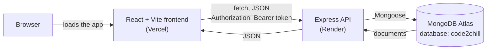
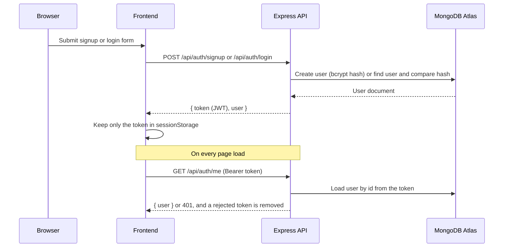
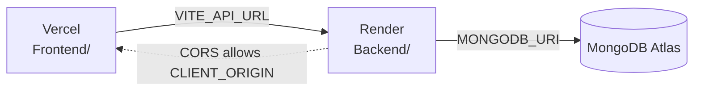

<div align="center">

# &lt;Code2Chill/&gt;

**Build. Connect. Innovate.**

The website and API for Code2Chill, the student-led developer community at Chitkara University.

[**Live website**](https://code2-chill.vercel.app/) · [Backend health check](https://code2chill-backend.onrender.com/api/health) · [Backend docs](Backend/README.md)

<br />


</div>

---

## Overview

Code2Chill is a coding community for programmers, software developers and AI enthusiasts at Chitkara University. This repository is the club's public website and the backend that powers it.

- **Who it's for:** students who want to find the club, see what it does and apply to join, and club leads who need somewhere to collect applications and publish events, projects and the team.
- **The problem it addresses:** a student community needs one dependable place to show what it does and to take new members in.
- **What it is:** a React single-page website backed by a REST API with real accounts (JWT) and a MongoDB Atlas database.

The repository has two parts:

| Folder | Contents |
| --- | --- |
| [`Frontend/`](Frontend) | React 19 + Vite single-page app, deployed on Vercel |
| [`Backend/`](Backend) | Express 5 + Mongoose REST API, deployed on Render. Full reference in [`Backend/README.md`](Backend/README.md) |

---

## Live Demo

| | URL |
| --- | --- |
| Website | https://code2-chill.vercel.app/ |
| API health check | https://code2chill-backend.onrender.com/api/health |

> **The backend can take up to a minute to respond at first.** It runs on Render's free instance, which goes to sleep when it hasn't been used for a while. The first request after a quiet period wakes it up, so the website may show a loading state or a connection error on the first visit. Wait a moment and reload. A healthy response looks like this:
>
> ```json
> { "status": "ok", "database": "connected", "uptimeSeconds": 2008, "timestamp": "..." }
> ```

---

## Features

### Implemented

- **User registration and login.** Signup and login against the API. Passwords are hashed with bcrypt before they are stored.
- **JWT authentication.** HS256 tokens; the session is restored on page load by checking the token with `GET /api/auth/me`.
- **User profile.** A protected page showing name, email, role and join date, plus a profile menu in the navbar and logout.
- **Join Us application form.** Validated in the browser and again on the server. One open (pending or reviewed) application per email, enforced by a database index.
- **Application storage.** Applications are saved in MongoDB. Admins can list them and change their status through the API.
- **Events listing.** Loaded from the API, with category and upcoming/past filters. Upcoming or past is worked out from each event's date.
- **Projects listing.** Loaded from the API, with a category filter, tech tags and GitHub/live links. Links and statistics that are missing are hidden.
- **Team section.** Leadership and Core Team, loaded from the API. The Home page member count comes from the same data.
- **Responsive frontend.** Floating navbar with a mobile menu, loading, error and empty states for API data, a 404 page, and page animations that switch off when the visitor prefers reduced motion.

### Planned (not implemented yet)

- An admin screen for reviewing applications (the API exists, the interface doesn't)
- Rate limiting, email verification and password reset
- See the [Roadmap](#roadmap)

---

## Tech Stack

Versions are the ranges declared in each `package.json`.

| Area | Technology |
| --- | --- |
| **Frontend** | React `^19.1.0`, React DOM `^19.1.0`, Vite `^6.3.0`, Tailwind CSS `^4.3.5` (with `@tailwindcss/vite`), React Router `react-router-dom ^7.18.6`, Lucide React `^1.77.0`, `@vitejs/plugin-react ^4.5.2`. JavaScript (JSX) only. |
| **Backend** | Node.js `>=20`, Express `^5.1.0`, cors `^2.8.5`, dotenv `^16.5.0`. ES modules. |
| **Database** | MongoDB Atlas, accessed with Mongoose `^8.16.0` |
| **Authentication** | jsonwebtoken `^9.0.2` (HS256), bcrypt `^6.0.0` (12 salt rounds) |
| **Deployment** | Vercel (frontend), Render (backend), MongoDB Atlas (database) |

Tailwind is configured in `Frontend/src/index.css`, so there is no `tailwind.config.js`.

---

## Architecture



**Sign up and log in**



- Public pages (events, projects, team, Join Us) call the API without a token.
- Protected API routes need `Authorization: Bearer <token>`. Admin routes also check that the user's role is `admin`.
- `GET /api/auth/me` reloads the user from the database each time, so a deleted account stops working straight away.
- Every frontend request goes through one file, `Frontend/src/services/api.js`.

---

## Project Structure

```text
Code2Chill/
├── README.md
├── Frontend/
│   ├── index.html · vite.config.js · vercel.json · .env.example
│   ├── public/                      # favicon
│   └── src/
│       ├── main.jsx · App.jsx       # entry point and route table
│       ├── index.css                # Tailwind setup and theme tokens
│       ├── pages/                   # Home, Events, Projects, Team, Join, Login, Signup, Profile, NotFound
│       ├── components/              # Navbar, Footer, ProfileMenu, AuthLayout, DataState, HeroCanvas, ...
│       ├── context/AuthContext.jsx  # session state: signup, login, logout, restore
│       ├── services/api.js          # all backend calls and error handling
│       ├── hooks/useApiData.js      # load data with loading / error / retry
│       ├── data/stats.js            # the three sample Home statistics
│       └── utils/                   # form validation, avatar initials
└── Backend/
    ├── server.js                    # entry: load config, connect DB, create indexes, listen
    ├── app.js                       # Express app: CORS, JSON parsing, routes, errors
    ├── config/                      # env.js (validate .env), db.js (Atlas connection)
    ├── models/                      # User, JoinApplication, Event, Project, TeamMember
    ├── controllers/                 # auth, join, content, health
    ├── routes/                      # /api/auth, /api/join, /api events/projects/team, /api/health
    ├── middleware/                  # requireAuth, requireRole, error handling
    ├── utils/                       # validation, JWT helpers, ApiError
    ├── data/seedData.js             # team, projects and sample events used by the seed script
    ├── scripts/                     # seed.js, makeAdmin.js
    └── .env.example
```

| Path | Responsibility |
| --- | --- |
| `Frontend/src/App.jsx` | Defines every website route |
| `Frontend/src/services/api.js` | The only place that talks to the backend; reads `VITE_API_URL` |
| `Frontend/src/context/AuthContext.jsx` | Stores the JWT and restores the session |
| `Frontend/vercel.json` | Rewrites every path to `index.html` so refreshing `/team` works |
| `Backend/server.js` | Starts the server only after the database connects; shuts down cleanly on SIGINT/SIGTERM |
| `Backend/config/env.js` | Stops the server with a clear message if `.env` is missing or invalid |
| `Backend/models/` | Mongoose schemas and indexes |
| `Backend/scripts/seed.js` | Loads the team, projects and sample events; safe to re-run |
| `Backend/scripts/makeAdmin.js` | The only way to give an account the admin role |

---

## Screenshots

Screenshots have not been added to the repository yet. To fill this gallery, save images at the paths below (a `docs/screenshots/` folder) and replace each "Not added yet" with ``.

| Page | Suggested file | Status |
| --- | --- | --- |
| Home | `docs/screenshots/home.png` | Not added yet |
| Events | `docs/screenshots/events.png` | Not added yet |
| Projects | `docs/screenshots/projects.png` | Not added yet |
| Team | `docs/screenshots/team.png` | Not added yet |
| Join Us | `docs/screenshots/join.png` | Not added yet |
| Login / Sign up | `docs/screenshots/auth.png` | Not added yet |
| Profile | `docs/screenshots/profile.png` | Not added yet |
| Mobile view | `docs/screenshots/mobile.png` | Not added yet |

---

## Getting Started

### Prerequisites

- [Node.js](https://nodejs.org/) **20 or later** (check with `node -v`)
- [Git](https://git-scm.com/)
- A MongoDB database: a free [MongoDB Atlas](https://www.mongodb.com/atlas) cluster (step-by-step in [`Backend/README.md`](Backend/README.md#mongodb-atlas-setup)) or a local MongoDB

### 1. Clone the repository

```powershell
git clone https://github.com/CodeWithPrinceX/Code2Chill.git
cd Code2Chill
```

### 2. Install dependencies

```powershell
cd Backend
npm install
cd ..\Frontend
npm install
cd ..
```

### 3. Configure environment variables

```powershell
Copy-Item Backend\.env.example Backend\.env
Copy-Item Frontend\.env.example Frontend\.env
notepad Backend\.env
```

In `Backend\.env`, set `MONGODB_URI` and `JWT_SECRET`. Generate a secret with:

```powershell
node -e "console.log(require('crypto').randomBytes(48).toString('hex'))"
```

The frontend's `.env` already points at `http://localhost:5000`. See [Environment Variables](#environment-variables).

### 4. Run the backend

```powershell
cd Backend
npm run seed     # first time only: loads the team, projects and sample events
npm run dev      # API on http://localhost:5000
```

Open `http://localhost:5000/api/health`. It should show `"status": "ok"` and `"database": "connected"`.

### 5. Run the frontend

In a second PowerShell window:

```powershell
cd Frontend
npm run dev      # site on http://localhost:5173
```

### Optional: make yourself an admin

Sign up on the website first, then:

```powershell
cd Backend
npm run make-admin -- your@email.com
```

### Scripts

| Folder | Command | What it does |
| --- | --- | --- |
| `Backend` | `npm run dev` | Start the API with auto-restart |
| `Backend` | `npm start` | Start the API (production) |
| `Backend` | `npm run seed` | Load the team, projects and sample events |
| `Backend` | `npm run seed -- --remove-samples` | Delete only records marked as samples |
| `Backend` | `npm run make-admin -- <email>` | Give an existing account the admin role |
| `Frontend` | `npm run dev` | Dev server with hot reload |
| `Frontend` | `npm run build` | Production build into `Frontend/dist/` |
| `Frontend` | `npm run preview` | Serve the production build on port 4173 |

---

## Environment Variables

Never commit real values. `.env` files are git-ignored; only the `.env.example` templates are committed.

### Frontend (`Frontend/.env`)

| Variable | Required | Example | Description |
| --- | --- | --- | --- |
| `VITE_API_URL` | Yes in production | `http://localhost:5000` | Public address of the backend API, without a trailing slash. In development it defaults to `http://localhost:5000`. |

> **Variables starting with `VITE_` are public.** Vite copies them into the JavaScript that every visitor downloads. Never put secrets, passwords or keys in them.

### Backend (`Backend/.env`)

| Variable | Required | Default | Description |
| --- | --- | --- | --- |
| `PORT` | No | `5000` | Port the API listens on (hosts like Render provide this themselves) |
| `NODE_ENV` | No | `development` | Set to `production` when deployed; hides error stack traces |
| `MONGODB_URI` | **Yes** | none | Connection string: `mongodb+srv://<db_username>:<db_password>@<cluster-host>/?retryWrites=true&w=majority` |
| `MONGODB_DB_NAME` | No | `code2chill` | Database name inside the cluster |
| `JWT_SECRET` | **Yes** | none | Secret that signs login tokens. At least 32 characters |
| `JWT_EXPIRES_IN` | No | `7d` | Token lifetime, for example `1h` or `7d` |
| `CLIENT_ORIGIN` | No | `http://localhost:5173,http://localhost:4173` | Frontend URL(s) allowed by CORS, comma-separated, no trailing slash |

The server refuses to start if `MONGODB_URI` or `JWT_SECRET` is missing or invalid, or if `MONGODB_URI` still contains a `<placeholder>`.

---

## API Documentation

Base URL: `https://code2chill-backend.onrender.com` (production) or `http://localhost:5000` (local).

| Method | Endpoint | Auth | Description |
| --- | --- | --- | --- |
| `GET` | `/api/health` | Public | API and database status (`503` if the database is down) |
| `POST` | `/api/auth/signup` | Public | Create a member account; returns `{ token, user }` |
| `POST` | `/api/auth/login` | Public | Log in; returns `{ token, user }` |
| `GET` | `/api/auth/me` | Bearer token | The current user |
| `POST` | `/api/join` | Public | Submit a Join Us application |
| `GET` | `/api/join` | Admin | List applications, newest first. Optional `?status=pending\|reviewed\|accepted\|rejected` |
| `PATCH` | `/api/join/:id/status` | Admin | Set an application's status |
| `GET` | `/api/events` | Public | List events |
| `GET` | `/api/events/:id` | Public | One event |
| `GET` | `/api/projects` | Public | List projects |
| `GET` | `/api/projects/:id` | Public | One project |
| `GET` | `/api/team` | Public | Team grouped into `leads` and `core`, plus `count` |

Errors are JSON: `{ "message": "...", "errors": { "field": "..." } }`, where `errors` appears for validation problems. Typical codes: `400` validation, `401` missing or invalid token or wrong login, `403` not an admin, `404` not found, `409` duplicate email or open application. Request and response examples are in [`Backend/README.md`](Backend/README.md).

---

## Database Models

Database: MongoDB Atlas, name `code2chill`. Every model also has `createdAt` and `updatedAt` timestamps.

**There are no references between collections.** A Join application is not linked to a user account, and the other collections stand alone.

### User

| Field | Type | Notes |
| --- | --- | --- |
| `name` | String | Required, 2 to 50 characters |
| `email` | String | Required, unique, stored lowercase, validated format |
| `password` | String | Required. Stored as a bcrypt hash, excluded from queries by default, never returned by the API |
| `role` | String | `member` (default) or `admin`. Cannot be set through the API |

### JoinApplication

| Field | Type | Notes |
| --- | --- | --- |
| `fullName` | String | Required, up to 80 characters |
| `email` | String | Required, lowercase, validated |
| `year` | String | Required: `1st Year`, `2nd Year`, `3rd Year`, `4th Year` or `Postgraduate` |
| `branch` | String | Required, up to 100 characters |
| `interests` | [String] | Any of the 8 interest options on the form |
| `experience` | String | Required: `Beginner`, `Intermediate` or `Advanced` |
| `github` | String | Optional link |
| `reason` | String | Optional, up to 1000 characters |
| `status` | String | `pending` (default), `reviewed`, `accepted` or `rejected` |
| `isOpen` | Boolean | `true` while `pending` or `reviewed`. Used by a unique partial index so each email can have only one open application |

### Event

| Field | Type | Notes |
| --- | --- | --- |
| `title` | String | Required, unique |
| `description` | String | Required |
| `date`, `time` | String | Display text such as `Dec 15, 2025` |
| `location` | String | Optional |
| `category` | String | Required |
| `startDate`, `endDate` | String | `YYYY-MM-DD`; the frontend uses them to decide upcoming or past (`endDate` optional) |
| `attendees` | Number | Optional |
| `isSample` | Boolean | `true` for placeholder content |

### Project

| Field | Type | Notes |
| --- | --- | --- |
| `title` | String | Required, unique |
| `description` | String | Required |
| `tech` | [String] | Technology tags |
| `category` | String | Required |
| `github`, `live` | String | Optional URLs |
| `stars`, `forks`, `contributors` | Number | Optional; left empty unless the numbers are real |
| `isSample` | Boolean | `true` for placeholder content |

### TeamMember

| Field | Type | Notes |
| --- | --- | --- |
| `name` | String | Required, unique |
| `role` | String | Required, for example `President` |
| `group` | String | `leads` (Leadership) or `core` (Core Team) |
| `order` | Number | Position within the group, lowest first |
| `bio`, `github`, `linkedin`, `twitter`, `avatar` | String | Optional; shown only when filled in |

---

## Deployment



### Frontend: Vercel

- **Live URL:** https://code2-chill.vercel.app/
- Root Directory: `Frontend`; framework preset: Vite; production branch: `main`
- Environment variable: `VITE_API_URL=https://code2chill-backend.onrender.com` (no trailing slash)
- `Frontend/vercel.json` sends every path to `index.html` so direct visits and refreshes on routes like `/team` work.

### Backend: Render

- **Live URL:** https://code2chill-backend.onrender.com/
- A long-running Node.js web service using the `Backend/` folder, started with `npm start`
- Environment variables (use your own values, never commit them):

  ```text
  NODE_ENV=production
  MONGODB_URI=<your Atlas connection string>
  MONGODB_DB_NAME=code2chill
  JWT_SECRET=<a long random string, at least 32 characters>
  JWT_EXPIRES_IN=7d
  CLIENT_ORIGIN=https://code2-chill.vercel.app
  ```

  Render supplies `PORT` itself. `CLIENT_ORIGIN` must exactly match the website's address, or the browser will block API calls. To also allow local development, list both, separated by a comma.
- Free instances sleep when idle, so the first request after a quiet period is slow.

### Database: MongoDB Atlas

- A database user with read and write access to the `code2chill` database
- **Network Access** must allow the backend. Render's free instances don't have a fixed IP address, so this usually means allowing `0.0.0.0/0`. If you do, the database password is the only protection, so use a long generated one.
- Load the team, projects and sample events once with `npm run seed` while `MONGODB_URI` points at the production database.

---

## Current Limitations

- **No admin dashboard.** Admins review applications through the API only (`GET /api/join`, `PATCH /api/join/:id/status`). The `admin` role can be granted only with `npm run make-admin` on the server.
- **Sample content.** All six events are placeholders dated 2025, so they show as past, and five of the six projects are placeholders. They carry a "Sample" label. Only the team and the Code2Chill Website project are real. Remove the samples with `npm run seed -- --remove-samples`.
- **Sample statistics.** The Projects, Events and Workshops figures on the Home page (`Frontend/src/data/stats.js`) are unverified and carry a "Sample figure" label. Only the member count is live.
- **Outdated notice on login and signup.** These pages still show a "Prototype only" message saying passwords aren't checked or saved. That is no longer true, because accounts are real. The component is `Frontend/src/components/PrototypeNotice.jsx`, and it still needs to be updated or removed.
- **No rate limiting, email verification or password reset.**
- **Token storage.** The JWT is kept in `sessionStorage`, which scripts on the page can read, and it clears when the tab closes. HTTP-only cookies would be stronger but need same-site hosting or CSRF protection.
- **Cold starts.** The first request after the free Render instance has been idle is slow.
- **No automated tests.** There is no test script in either `package.json`.
- **No screenshots** in the repository yet.

---

## Roadmap

- [ ] Admin screen for reviewing and updating Join applications
- [ ] Replace sample events, projects and statistics with real ones
- [ ] Remove or update the outdated "Prototype only" notice
- [ ] Rate limiting on login, signup and Join Us
- [ ] Email verification and password reset
- [ ] Automated tests for the API and key frontend flows
- [ ] Add screenshots to this README
- [ ] Choose and add a license

---

## Contributing

1. Fork the repository and create a branch: `git checkout -b feature/your-change`
2. Run the backend and frontend locally ([Getting Started](#getting-started)) and check your change in the browser.
3. Make sure `npm run build` succeeds in `Frontend/`.
4. Never commit `.env` files or credentials.
5. Commit with a clear message and open a pull request describing what changed and why.

## License

No license has been chosen yet. Until one is added, all rights are reserved by the project maintainers.
